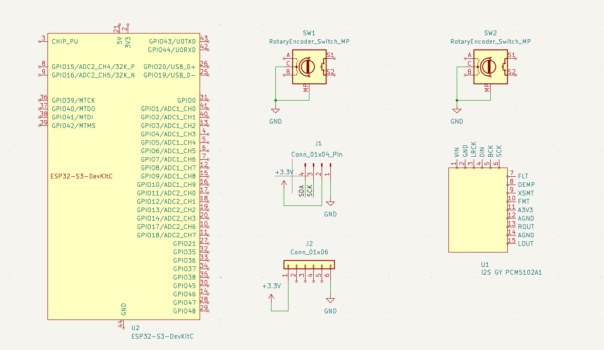
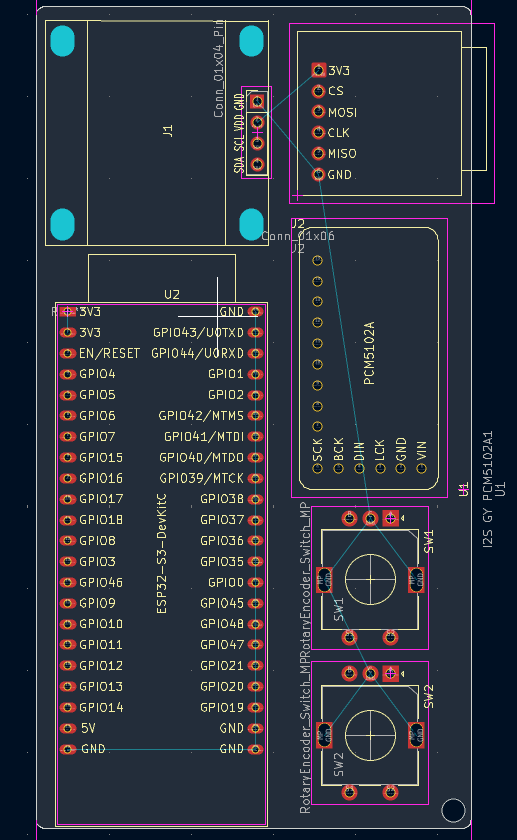

# Kiwo Player
kiwo is a small portable MP3 player.
It can also be used as a very cool looking keychain!

[Image coming sooooooooooooooooooooooooooooooooooooooooooooon]

Insert you favorite songs into micro SD card, plug it in the kiwo player, click play and enjoy!

## About the Project

I got the inspiration from a reel that I saw on Instagram, a small MP3 player on a prefboard. Back then I hadn't even realized that I could build something
that cool by myself. I've loved music and building things since a kid and I thought that I should try to make something that connects both. Similar motivation to my previous
project, the midi keypad from Kai Pereira. Music is never to much!

If I am making something that looks awesome might as well make it visible to others. So I came up with the Idea of making it a keychain. 
Now you can listen to music anywhere you want, as long you have the kiwo player and headphones with you!

## Process

In the beginning I researched a lot about MP3 players. How they work, their connections, their components and its functions etc.
It was quite confusing but I learned tons of new knowledge in this area.

Some things weren't as useful to research, such as how KiCad works, because you learn it better by experimenting.

Then I started to chose my components, which didn't take too long. MP3 player usually have the same structure.
Right after I started the wiring but then the first problems popped up. 

### Difficulties

- Symbols and footprints
  Symbols and footprints for some of the components I wanted to use weren't available in the KiCad library or online so I had to learn how to create those myself...

- Wiring
  This still overwhelms me now. This process (at least for me) took me a lot of time. I had to learn about different protocols, connections and functions. Then needed
  to research about very component to know which pins to use and how to connect them. Lastly I had to fix tons of mistakes.

### Schematic 

### Front Cu layer

### Back Cu layer

### Currently working on ... 

- routing

### Next steps ...

- Firmware

## Do it yourself!

I will write a guide for you to try making your own MP3 and customize it as you wish!

It will be available as soon as possible...

## BOM

